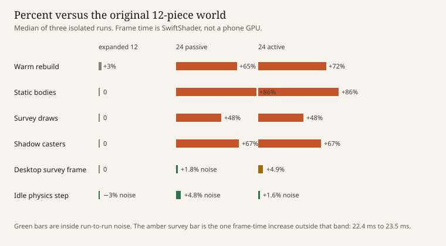

# Capacity 24 measurement

What does doubling Worldcraft's physical piece capacity actually cost, and can that cost be taken on for larger agent-authored worlds?

This is a measurement. It does not retune physics, launch, sound, or the mix limiter, and it does not claim that a world is fun, musical, or ready for a phone.

## Identity

| | |
| --- | --- |
| Start | `9ceb189cbc2bb91322d11b293c6f0bd603fcb861` on `lab/wc-exp-20261110-descending-resonance` |
| Baseline harness | `7653910249e3a35a33f6f0eccbecbf1b4c4164b9`. The original-12 JSON files record `gitSha` `9ceb189`, because they were written before that commit. The code under test for those runs is that commit plus the `qa=1` timers. Those timers do not change physics. |
| Opt-in | `a95de239f4c3347cddcd247ffcae205587c627a6` |
| Fixtures and the later three columns | `7d89a03d037a0ac833b12e1d09078e6d5d786bf3` |
| v1 export hash | `127a033284941a110bd174e59e51700f5bdce4ca3b74a6f6c381786586141389`, unchanged |

The piece-count badge was still hardcoded to `/12` when the frames were recorded, so a 24-piece world displayed `24/12`. The badge now uses 24 only when the document opts in. That text change is after the timings. It does not affect the scene, the draws, or the shots.

## Machine

Every run recorded the same host.

- Linux 6.12.113+ x64, 4 cores, `Intel(R) Xeon(R) Processor`. `os.cpus()` reported speed 0, so no clock is stated.
- 16,780,623,872 bytes of memory reported to Node (15.6 GiB). This VM can hide memory in a hypervisor balloon. The runs did not OOM.
- Node v22.23.4.
- Google Chrome 157.0.8103.50, headless, SwiftShader.
- WebGL renderer, every viewport and every run: `ANGLE (Google, Vulkan 1.3.0 (SwiftShader Device (Subzero) (0x0000C0DE)), SwiftShader driver)`.
- WebGL 2.0 (OpenGL ES 3.0 Chromium).

The window inner size matched the request: 1280×800, 390×844, 844×390. The lab chrome makes the WebGL canvas smaller: 1000×703, 390×260, and 624×311. Both sizes are in the raw files.

Cold and warm are separate. Each of the three runs is its own process. A delta is called **no measurable difference** when its relative size is within the larger of the two columns' run-to-run ranges, `(max − min) / median`. Headless Havok step times are not browser frame times.

## What changed, and what the 12 cap still is

`WORLDCRAFT_LIMITS.objects` stays 12. A document may set `capacity: 24`. Anything else is rejected. Absent means 12, and the returned world omits the key, so existing documents and the v1 export stay byte-identical. Identity appends `capacity` only when it is 24.

The enforced 12s after the opt-in:

- `lib/worldcraft-model.js:10` — `WORLDCRAFT_LIMITS.objects` is 12.
- `lib/worldcraft-model.js:166` — no `capacity` field means 12. Only 24 is accepted (`:167`).
- `lib/worldcraft-model.js:179` — object count. The default message is still "at most 12 pieces".
- `lib/worldcraft-model.js:212` — the validated world carries `capacity` only when it is 24.
- `lib/worldcraft-model.js:274` and `:345` — locked-list length uses that capacity.
- `lib/worldcraft-model.js:351` — allowance. The default message is still "0–12".
- `lib/worldcraft-model.js:415` — `worldcraftCanAdd` uses 12 unless `world.capacity === 24`.
- `lib/worldcraft-model.js:525` — identity includes capacity only for 24.
- `lib/worldcraft-foundry.js:89` — a tested-shot layout is still 1–12 objects unless the preset opted in.
- `lib/worldcraft-model.d.ts:35` — the limits type is still `objects: 12`.
- `tests/worldcraft-music3-scope.test.mjs` still asserts `WORLDCRAFT_LIMITS.objects === 12`.

These are not piece caps, and they were not raised: import 32 KiB (`worldcraft-model.js:507`), recorded line 256 KiB (`:603`), history 100 (`:550`), foundry manifest 16 KiB (`worldcraft-foundry.js:148`), QA trace 500 (`app/lab/worldcraft/worldcraft.tsx`). The launcher corridor of x = ±12 is a physical bound, not the piece cap. The mix limiter was not given a voice cap and was not retuned.

No existing foundry world was edited. Descending Resonance and Ricochet Garden Loop still replay, including Ricochet layouts. The new fixtures are separate studies.

## Fixtures

Both start from the twelve Descending Resonance pieces at the same transforms. Twelve catalog pieces are added, all locked, allowance empty, launcher unchanged, goal none, `capacity: 24`.

- **Passive** (`capacity-24-passive`). Twelve standing plates at the back of the yard, z = 72 and z = 84. The seven Descending tested shots match the recorded terminals and contact order, and none of them names a back plate.
- **Active** (`capacity-24-active`). Six banks and six plates east of the original walls. `opening`, `descent`, and `four` still match and do not name an east piece. `east-rake` (yaw 16, elevation 10, charge 0.55) takes seven contacts, all on the added pieces, with a closest impact gap of 100 ms. Metal's fundamental decay is 1.85 s, so those notes overlap. The shot ends on first ground.

They are measurement layouts, not levels. Load them from Foundry, studies section: Capacity 24 Passive and Capacity 24 Active.

## How to repeat

Headless, one column, three fresh processes:

```
node scripts/capacity/measure-headless.mjs \
  --column expanded-12 --world descending-resonance \
  --switch descending-resonance-flat --few opening --many four \
  --runs 3 --cycles 60 --out docs/experiments/capacity-24/raw
```

The 24 columns use `--world capacity-24-passive --switch capacity-24-active --few opening --many four` and `--world capacity-24-active --switch capacity-24-passive --few opening --many east-rake`.

Browser, with `npm run dev -- --host 127.0.0.1 --port 5173` already up:

```
node scripts/capacity/measure-browser.mjs \
  --column expanded-12 --url http://127.0.0.1:5173/lab/worldcraft?qa=1 \
  --world descending-resonance --switch descending-resonance-flat \
  --few opening --many four \
  --probe docs/experiments/capacity-24/raw/expanded-12-headless-run-1.json \
  --runs 3 --cycles 50 --out docs/experiments/capacity-24/raw
```

Raw JSON is under `docs/experiments/capacity-24/raw/`. The directory is 976 KB. No traces, videos, or WAVs are in Git. Desktop survey screenshots from run 1 of each column are cloud-agent artifacts, not committed.

`scripts/capacity/place-fixtures.mjs` rebuilds the two presets and checks the original shots before writing them.

## Comparison

Values are the median of three runs. The bracket is the run minimum and maximum. Percent is against the original 12. "Noise" means the percent sits inside the run-to-run band defined above.

### World loading

| | orig 12 | expanded 12 | 24 passive | 24 active |
| --- | --- | --- | --- | --- |
| Cold Havok construct | 18.38 ms [17.94–19.06] | 18.46 ms [18.34–18.82] +0.5% noise | 21.54 ms [21.36–21.78] +17% | 21.59 ms [21.44–22.24] +17% |
| Warm rebuild, median | 3.43 ms [3.36–3.53] | 3.54 ms [3.47–3.55] +3.4% noise | 5.65 ms [5.60–5.72] +65% | 5.90 ms [5.76–5.93] +72% |
| Warm rebuild, p95 | 5.95 ms [5.27–6.87] | 5.65 ms [5.37–5.67] −5% noise | 7.73 ms [7.60–7.98] +30% | 8.10 ms [7.99–9.15] +36% |
| Browser world load, desktop | 75.3 ms [68.2–79.0] | 77.4 ms [75.0–80.2] +2.8% noise | 88.0 ms [78.4–97.0] +17% noise | 81.1 ms [77.7–85.4] +7.7% noise |
| Switch world, replace | 2.50 ms [2.46–2.63] | 2.55 ms [2.49–2.59] +2% noise | 5.67 ms [5.11–6.22] +127% | 4.82 ms [4.80–4.88] +93% |

The first browser cold load is a Vite compile, 1.1–3.0 s, and that spread swamps any world difference. It is not a world-load number. Warm rebuild of a 24-piece world stays under 10 ms. The old desktop rebuild budget cited in `docs/WORLDCRAFT-LAB.md` is 50 ms. That budget is a reference, not a phone result.

Expanded-12 did not move world load outside noise. The two step-time decreases that fall just outside the band are under a millisecond (idle p95 0.0088 → 0.0069 ms, many-contact step median 0.0125 → 0.0119 ms). They are not a cost increase, and they are not a tuning change. Contact order and terminals on the seven Descending shots and the six Ricochet shots stayed matched.

### Physics (headless Havok, 120 Hz)

| | orig 12 | expanded 12 | 24 passive | 24 active |
| --- | --- | --- | --- | --- |
| Idle step, median | 0.0063 ms [0.0063–0.0066] | 0.0061 ms [0.0061–0.0061] −3% noise | 0.0066 ms [0.0065–0.0070] +5% noise | 0.0064 ms [0.0063–0.0065] +2% noise |
| Few-contact step, median | 0.0129 ms [0.0129–0.0135] | 0.0127 ms [0.0124–0.0165] −2% noise | 0.0132 ms [0.0129–0.0136] +2% noise | 0.0131 ms [0.0125–0.0131] +2% noise |
| Many-contact step, median | 0.0125 ms [0.0124–0.0126] | 0.0119 ms [0.0118–0.0123] −4.8% | 0.0124 ms [0.0120–0.0128] −0.8% noise | 0.0116 ms [0.0109–0.0121] −7% noise |
| Static bodies | 14 | 14 | 26 | 26 |
| Closest impact gap | 241.7 ms | 241.7 ms | 241.7 ms | 100.0 ms |

Few-contact is `opening` (one contact, `wall-near-e`) in every column. Many-contact is `four` (four contacts) for the first three columns, and `east-rake` (seven contacts) for 24 active. Adding twelve bodies did not show up in the step time. The solver cost of these shots is about a hundredth of a millisecond and sits inside the run noise. The body count is the real difference: 24 pieces plus ground plus tee is 26 static bodies.

### Rendering (browser, SwiftShader)

`scene.render` CPU time stays about 0.6 ms median. The frame period is the user-visible number, and on this software renderer it includes present and scheduling outside that callback. Physics time inside the frame callback is about 0 ms, which matches the headless step times and is not the frame.

| | orig 12 | expanded 12 | 24 passive | 24 active |
| --- | --- | --- | --- | --- |
| Desktop survey frame, median | 22.4 ms [22.0–22.8] | 22.4 ms [22.1–22.8] 0% noise | 22.8 ms [22.7–23.0] +1.8% noise | 23.5 ms [23.4–23.8] +4.9% |
| Desktop survey frame, p95 | 24.3 ms [23.8–24.6] | 24.4 ms [24.1–24.9] +0.4% noise | 24.8 ms [24.2–25.2] +2% noise | 26.3 ms [25.6–26.4] +8.2% |
| Desktop many-contact flight, median | 29.7 ms [29.0–34.9] | 29.7 ms [29.3–31.0] 0% noise | 28.3 ms [28.2–29.1] −5% noise | 26.4 ms [26.0–26.6] −11% noise |
| Portrait and landscape survey | 16.7 ms | 16.7 ms | 16.7 ms | 16.7 ms |
| Survey draws | 50 | 50 | 74 (+48%) | 74 (+48%) |
| Shadow casters | 18 | 18 | 30 (+67%) | 30 (+67%) |
| Meshes | 14 | 14 | 26 | 26 |
| Materials | 18 | 18 | 18 | 18 |
| Textures | 1 | 1 | 1 | 1 |
| `scene.render` CPU, desktop survey | 0.6 ms | 0.6 ms | 0.6 ms | 0.6 ms |

Portrait and landscape stay on the 16.7 ms tick in survey and in flight, at both capacities. That means a cost smaller than one tick is invisible there. It is not evidence about a phone GPU.

The one frame-time increase outside the run band is the 24-active desktop survey: 22.4 ms to 23.5 ms median, p95 24.3 ms to 26.3 ms. Draws go from 50 to 74 and casters from 18 to 30 on both 24-piece scenes, so the extra millisecond is not explained by the active shot. It is a small, repeatable survey difference on SwiftShader. The old reference budgets were ≤160 draws and ≤32 shadow casters. These scenes are inside those counts. 30 casters leaves little room under 32 if later scenery adds casters. That did not move this machine off a ~23 ms survey.

In-flight draw medians: 46 for both 12-piece columns, 57 for the passive `four` shot, 47 for `east-rake`. The active flight's lower desktop frame median (26.4 ms, and the run range does not overlap the original 29.0–34.9 ms) is a different shot, with the camera and the ball elsewhere. It is not a rendering win to bank.

### Editor

Descending Resonance is locked, so a fair move unlocks one piece on a preset copy. The probe is `wall-far-e` to x = 8.5 on the 12-piece worlds, `back-8` to x = 21.5 on the passive fixture, and `east-12` to x = 24.5 on the active fixture. Selection stays under 0.2 ms.

| Desktop | orig 12 | expanded 12 | 24 passive | 24 active |
| --- | --- | --- | --- | --- |
| Nudge, including rebuild | 4.6 ms [4.3–5.0] | 4.8 ms [4.4–4.9] +4% noise | 7.3 ms [7.1–9.2] +59% | 7.3 ms [7.1–7.5] +59% |
| Rebuild inside that nudge | 3.5 ms [3.2–3.9] | 3.5 ms [3.4–3.7] 0% noise | 4.9 ms [4.8–6.0] +40% | 5.0 ms [4.8–5.3] +43% |
| Piece list, scroll / client | 572 / 165 | 572 / 165 | 1148 / 165 | 1148 / 165 |

Portrait list client height grows with the rows: 289 px for 12 pieces and 583 px for 24, and `scrollHeight` equals `clientHeight`, so the portrait list does not scroll. Landscape client height stays 96 px, so 24 rows (1148 px) need a long scroll. The list is still the same control. No layout was redesigned. Build remained usable at 1280×800: the nudge completed, the notice was "moved", and the piece badge reads `24/24` after the label fix (`12/12` on Descending Resonance).

### Memory and leaks

Live scene counts do not grow.

Headless, 60 cycles alternating the column's two worlds, three runs. Static bodies, physics bodies, meshes, materials, and textures have slope 0 (14 or 26 bodies by world, 12 scene meshes on the flat control, 32 on a 24-piece world). After `runtime.dispose`, scene meshes, materials, textures, and physics bodies are 0. Node `heapUsed` rose about 0.6–0.7 MB per recorded 12-piece sample and about 1.2–1.4 MB per 24-piece sample. The headless process did not force a GC, so that figure mixes garbage with anything retained. It is not a growing collider or mesh count.

Browser, 50 cycles, `HeapProfiler.collectGarbage` before each read, three runs. Static bodies, meshes, materials, textures, shadow casters, and active voices have slope 0. Heap still rose, and the rise repeats:

- original 12, Descending Resonance: about 110 KB per sample (44.8 MB → 48.8 MB)
- original 12, the flat control: about 92 KB per sample
- expanded 12: about 101 KB and 93 KB
- either 24-piece world: about 112–117 KB per sample (about 45.8 MB → 49.2 MB)

`playFoundry` commits every load into undo history, capped at `WORLDCRAFT_LIMITS.history` (100). The QA trace keeps 500 events and then drops the oldest. Fifty cycles have not filled either cap, so the slope is those stacks filling. It is bounded by those caps. It is not an unbounded leak of colliders, meshes, materials, textures, or audio nodes. `release()` returns the live voice count to 0.

### Audio

The limiter is unchanged: pre-gain 1/16, knee 0.85, ceiling −1 dBFS. Twelve simultaneous full-strength metal notes and twenty-four of them both peak at 0.89125. Twelve already sit on the ceiling for 1344 samples of a 2.1 s offline render (60 nodes). Twenty-four sit there for 3288 samples (120 nodes). The offline render itself is about 57–60 ms either way. This was identical on every column, because it does not depend on the world.

A live burst of 12 impacts left the context `running`. After `release()`, active voices were 0 (started 86, cleaned 50, finished 36 on the original desktop run, which still included nodes from the shots just fired). `east-rake` overlaps by the 100 ms gap against the 1.85 s metal fundamental. Nobody listened to it. The limiter was not redesigned. Twelve full-strength notes already reach the ceiling, so twenty-four notes do not get louder. They spend longer pinned.

## Chart



Rebuild, body count, draws, and shadow casters move with the piece count. The idle physics step does not. The desktop survey frame barely does, and only the 24-active survey median clears the run-to-run band.

## Recommendation

**Technical.** The opt-in is enough. Validation, the scene build, and the runtime are per-object loops. A 24-piece document loads, fires, rebuilds, and disposes. Existing 12-piece documents, the v1 hash, and the previously tested shots stay put. No rewrite was required.

**Adequate on the measured desktop browser.** On this SwiftShader session, a 24-piece world rebuilds in about 6 ms, surveys at about 23 ms, and flies inside the noise of the 12-piece flight. The editor nudge is about 7 ms. The piece list scrolls, and portrait still fits. That is the machine and the renderer that were measured.

**Needs phone validation.** The renderer is SwiftShader. Portrait and landscape here are a resized desktop browser on a software GPU, and their frames sit on the 60 Hz tick. The historical phone targets (rebuild p95 ≤ 100 ms, warm frame p95 ≤ 33 ms) were not measured on a phone. Meeting the old draw and caster counts on SwiftShader does not establish them.

**Needs optimization.** Not for the cost this study could see. Do not raise the default, and do not retune the limiter or the solver from these numbers. The caster count of 30 is close to the old reference of 32. That is a budget fact for whatever scenery a later world adds. It was not a frame-time failure here.

The smallest safe path to a 24-piece authored world is the field that already exists. A document sets `capacity: 24` and may hold 24 catalog pieces. Documents without the field stay 12-piece worlds, with the same bytes and the same identity. No format version bump is required for them. New authored worlds that want 24 pieces should set the field explicitly and should be new presets, not edits of Descending Resonance or the other foundry worlds.

## Is 16 or 18 worth a separate cap?

Not from these measurements. The costs that scale, rebuild and draws and bodies and casters, move between 12 and 24 without a cliff. The costs that dominate the frame on this renderer, the tick and the present, barely move. A 16-piece or 18-piece world was not built and was not timed, so there is no measured value for either. The only budget that gets tight at 24 is the old shadow-caster reference of 32, and these scenes use 30. Choosing 16 or 18 to stay clear of that reference would be a product choice, not a result this study measured.

## What was not verified

- A physical phone, a mobile GPU, and the phone frame and rebuild targets.
- Any browser GPU other than SwiftShader. Chrome was launched with `--use-angle=swiftshader-webgl`.
- Speaker playback. Overlap is an impact gap and an offline render, not a listen.
- Whether a 24-piece world is fun, playable as a level, or musically better. These fixtures are not levels.
- 16-piece and 18-piece worlds. The opt-in accepts only 24.
- A production `workers.dev` build's frame times. Browser numbers are from the Vite dev server. The first load includes compilation.
- Filling the history cap of 100 or the trace cap of 500. The leak runs stopped at 50 and 60 cycles, while those stacks were still growing.
- Editing every piece. One legal nudge per world was timed. The authored foundry files were not modified by that nudge.
- Projectile physics, restitution, gravity, launch mapping, and collider shapes. They were required to stay put, and the matched shots are the check, not a new physics sweep.
- Unlocked 24-piece authoring from an empty clearing, beyond the validation tests that a 24-plate document round-trips and that piece 25 is rejected.
