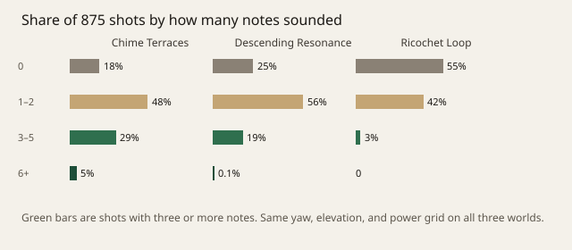

# Chime Terraces — terraced cascade

Lane A of the chime study. The question is whether a shot that descends through tiered sounding surfaces produces more accessible multi-note runs, and more than one phrase family, than Descending Resonance and Ricochet Loop.

## The arrangement

Twenty-one existing pieces. Three timber ramps at z = 16 (x = −11, 0, 11). Behind them, three rows of six metal plates, 4 m apart in x, at z = 24, 29, and 34. Lifts are 2 m, 6 m, and 10 m. Every plate tilts −15°, so the top leans toward the tee and a high ball is turned down. Capacity is the opt-in 24. Nothing else in the physics contract changed: gravity, restitution, first-ground termination, and the launch mapping are the ones already in the build this branch was cut from (`6d9da5d`).

The scale is the existing major pentatonic, degrees 0–4 as C4 D4 E4 G4 A4. Columns are tuned so a descent of a column falls in pitch: A–E–C, G–D–C, A–G–D, G–E–C, G–E–D, E–D–C from west to east. The centre ramp is E4, so a climb off it into the centre high plates (A4 and G4) can continue to a mid-row E4. Plates are ordinary metal, which rings. Ramps are ordinary timber, which is the short knock. The timber-bank voices (variants G, H, and I) apply only when the piece is a timber bank. This world has no banks, so that presentation flag is off. Variants C–F would retimbre the ramps and leave the plates as ordinary metal; the plates are the chimes, so those variants were not selected. The world uses face-speed gain and the existing note timeline.

## What was discarded

The searches below used a coarse aim set, not the 875-shot protocol. They were discarded before the world was locked.

- Flat and uniform plate grids, including 3×8 and 4×6 at several depths and leans, could push the share of 3-note shots up to about a third. The long shots were mostly a ball rattling between two rows. A count of shots that used three distinct pieces and were not dominated by two of them never beat Descending Resonance on that coarse set.
- Shelves tilted the other way (the top facing up) almost never chained. A positive tilt does not turn a high ball down into the next row.
- Steeper front dumps, zigzag offsets, separated aisles, and plates yawed into a sideways glissando split into many tiny families. The share of shots that walked three distinct pieces stayed near a tenth.
- Three separated bays, each a ramp plus a private two-step staircase, went silent about 40% of the time. The centre ramp still collected shots that were aimed at a side bay.
- A first staircase used 25 pieces and was rejected by the cap. One layout overlapped. One id used a capital letter and was rejected by the identifier rule.
- On the full 875-shot grid, tilt −20° gave a slightly lower 3-note share than tilt −15°, and a graduated lean (−30° / −20° / −10°) was lower again. −15° was kept for accessibility. Pitches do not affect the solver, so the locked geometry is that −15° terrace.

A monotonic walk down three different rows, common and stable, did not appear inside the current pieces. Plates are 4 m wide, restitution on a plate is 0.86, and the shot ends at the first touch of the ground. Two rows chain. Three rows in one descending line are rare. No new piece type, restitution, or termination rule was added.

## Protocol

Same harness as the Ricochet Loop and Descending Resonance reproductions (`scripts/range/run.mjs`, Havok, 120 Hz, substep 1000/120). Seed `20261114` is recorded and not applied.

The grid is the Ricochet Loop 875-shot grid, unchanged:

- yaw −24° to 24°, step 2° (25 values)
- elevation 8°, 12°, 16°, 20°, 24°, 30°, 40°
- charge 0.35, 0.45, 0.55, 0.65, 0.8

A phrase family is the first three distinct sounding pieces after immediate repeats are collapsed. A shot with fewer than three distinct pieces is its own short family, named by that whole collapsed order. Silent shots are one family. Regions are left (yaw ≤ −8°), centre (−6° to 6°), and right (yaw ≥ 8°), crossed with low (elevation ≤ 20°) and high (elevation ≥ 24°). A nudge is one slider detent: ±0.5° yaw, ±0.5° elevation, ±0.01 charge. “All six” means every one of those nudges.

Contact orders below are piece bodies in ledger order, ground and tee omitted, repeats kept. The earlier Loop write-up reported 47 such orders on this grid. This remeasure got 48. The table uses the remeasure for all three worlds. Note sequences are the ear, which collapses callbacks inside the hold window, so a ledger repeat can be one note.

## Metrics

875 shots each. Long means three or more notes.

| | Chime Terraces | Descending Resonance | Ricochet Loop |
| --- | ---: | ---: | ---: |
| Pieces | 21 | 12 | 10 |
| Distinct piece-contact orders | 240 | 113 | 48 |
| Distinct ledger orders, including ground | 257 | 143 | 56 |
| Distinct note sequences | 235 | 115 | 48 |
| Phrase families | 189 | 94 | 42 |
| 0 notes | 159 (18.2%) | 220 (25.1%) | 478 (54.6%) |
| 1–2 notes | 421 (48.1%) | 489 (55.9%) | 371 (42.4%) |
| 3–5 notes | 255 (29.1%) | 165 (18.9%) | 26 (3.0%) |
| 6+ notes | 40 (4.6%) | 1 (0.1%) | 0 |
| Shots with 3+ notes | 295 (33.7%) | 166 (19.0%) | 26 (3.0%) |
| Yaw nudge still 3+ / same family | 80.3% / 52.0% | 94.9% / 79.2% | 67.3% / 50.0% |
| Elevation nudge still 3+ / same family | 85.9% / 58.1% | 76.5% / 55.4% | 57.7% / 44.2% |
| Power nudge still 3+ / same family | 87.6% / 62.7% | 80.4% / 57.2% | 73.1% / 50.0% |
| All six nudges still 3+ | 54.2% | 51.8% | 26.9% |
| All six nudges, same family | 9.2% | 22.3% | 7.7% |
| Median distinct pieces on a 3+ shot | 3 | 3 | 3 |
| Mean distinct pieces | 2.78 | 2.75 | 3.04 |
| Distinct-piece distribution on 3+ shots | 2: 89, 3: 183, 4: 23 | 2: 59, 3: 90, 4: 16, 5: 1 | 2: 5, 3: 15, 4: 6 |
| Share of all notes from the two most-hit pieces | 26.8% | 42.3% | 38.4% |
| Median / mean ping-pong | 0.67 / 0.77 | 0.75 / 0.79 | 0.75 / 0.73 |
| Sounding pieces reached by a 3+ shot | 21 / 21 | 12 / 12 | 9 / 10 |
| 3+ shots whose first three onsets span ≥ 0.15 s | 66.1% | 64.5% | 80.8% |
| Median gap between consecutive notes | 0.20 s | 0.53 s | 0.23 s |
| Consecutive note gaps under 50 ms | 114 / 901 | 10 / 415 | 0 / 72 |

Ping-pong is the share of a shot’s notes that come from its own two most-hit pieces. The two-piece share in the row above is global: the centre ramp alone is 373 of 1885 notes (19.8%), and the east ramp is next at 7.0%. Low shots from a wide band of yaw land on the centre ramp and get lofted sideways. The plates that follow still depend on the aim.

The largest families are short. Silence is 18.2%. A single east ramp or a single west ramp is 3.4% each. No three-piece family is larger than a handful of shots. The leaders by region, and their count inside that region, are:

| Region | Shots | Leading families |
| --- | ---: | --- |
| Left, low | 180 | centre ramp → west-outer high → west-outer mid (5); centre ramp → west-inner high → west-inner mid (5) |
| Left, high | 135 | no family larger than 2 shots |
| Centre, low | 140 | centre ramp → centre-left high → centre-right high (6); three other centre-ramp families at 5 |
| Centre, high | 105 | centre-left mid → centre-right mid → centre-right low (4) |
| Right, low | 180 | centre ramp → east-inner high → east-inner mid (5); centre ramp → east-outer high → east-outer mid (5) |
| Right, high | 135 | centre-right mid → east-inner mid → east-inner low (4) |

Left, centre, and right do yield different plates. They do not yield one phrase you can sit on. A region leader is 4 to 6 shots out of 105 to 180.

Of the 295 long shots, 195 space the first three distinct onsets across at least 0.15 s. The other 100 cluster them. The recorded centre drop is the clustered kind: G4 and E4 at the same instant, then C4 0.23 s later. The recorded centre climb is the same shape one row higher: A4 and G4 together, then E4. Adjacent 4 m plates share a bounce often enough that 114 consecutive notes begin within 50 ms of each other.

## Recorded sound

Five shots were rendered offline through `renderResonanceWav` in `lib/worldcraft-resonance.js`, the synthesis the lab uses, at face speed, then encoded to Opus. Level match was not applied. Speaker playback was not done. The files are under the artifact directory `chime-terraces/`, and the hashes are in `audio-manifest.json`.

| Shot | What the render contains | Peak | RMS |
| --- | --- | ---: | ---: |
| Centre climb | Timber E4 (gain 0.23) at 0.39 s, then metal A4 and G4 together (gain 0.53) at 1.46 s, then metal E4 (gain 0.20) at 1.79 s | 0.516 | 0.027 |
| Centre drop | Metal G4 and E4 together (gain 0.82) at 0.96 s, then metal C4 (gain 0.71) at 1.19 s | 0.792 | 0.049 |
| West climb | Timber E4, then metal A4, E4, A4, E4 from 1.52 s to 2.70 s, each quieter than the last pair | 0.240 | 0.025 |
| East climb | Timber E4, then metal G4 at 1.75 s, then metal E4 at 2.17 s | 0.159 | 0.016 |
| Near miss | One timber C4 at 0.63 s | 0.108 | 0.004 |

The centre drop is the loudest file and the one that reads as a fall: a two-note chord, then a lower note. The climbs start with a quieter timber knock than the metal that follows, because face speed scores the ramp graze below the plate strike. The near miss is a quiet single knock. None of this was judged by ear on a speaker.

## Cost and the lab page

Headless, one NullEngine run, the capacity-study script: warm rebuild median 8.3 ms (p95 14.3 ms), idle step median 0.0068 ms, flight step median 0.013 ms on both the one-contact shot and the six-contact shot. The capacity study’s 24-piece warm rebuild sat near 5.9 ms across three runs. This single run is higher than that band. The step times sit with that study’s step times. Ricochet Loop and Descending Resonance tested shots still matched in the same process.

Browser frames, one headless Chrome run, SwiftShader, 1280×800: survey median 31 ms, p95 34.1 ms. The six-contact flight median was 30.6 ms, p95 46.7 ms. The capacity study’s 24-piece desktop survey was about 23.5 ms median and 26.3 ms p95. This run is one sample on a different world, and it sat higher. Portrait and landscape frames sat on a 16.7 ms tick in the same run. That is a resized desktop browser on a software GPU, not a phone.

In the lab page, all seven tested shots matched the manifest contact list and the terminal bit for bit, including elapsed time. The orbit view shows three ramps and three rising rows. The address view from the tee shows the ramps large and the plates as a stacked dark band. After the centre-drop shot, the side survey shows the arc and the note line reads plate G4, plate E4, plate C4.

Build lists 21 piece buttons. On the desktop the list box is 165 px tall and the content is 1004 px, so it scrolls. On an 844×390 landscape the same list is a 96 px box. The invitation sits above it in a 220 px side dock, so the list and the fire control are below the first screen of that dock.

## Verdict

On this grid the terrace is the more findable of the three musical worlds: 295 of 875 shots sound three or more notes, against 166 on Descending Resonance and 26 on Ricochet Loop, with fewer silences and with notes less concentrated on two pieces. Every sounding piece is reached by some long shot, and the left, centre, and right bands lead with different plates. It is not one staircase, and it is not a phrase you can hold. The biggest three-piece family in a region is six shots. Only 9% of the long shots keep the same first three pieces through all six nudges, while 54% still have three or more notes after every nudge, so a small aim change usually keeps a run and changes which plates it is. About a third of the long shots bunch the first three onsets inside 150 ms, and the mean ping-pong of 0.77 is in the same range as Descending Resonance. The instrument you can revisit is a set of neighbouring two-row lines, some of them a chord and a following note, fed often by the centre ramp.

## Not verified

A physical phone, a speaker, and whether a person wants to play it again. Frame times are one SwiftShader run. The coarse searches that were discarded were not the 875-shot grid.
