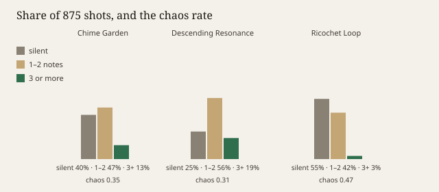

# Chime Garden

Lane C of the Chime Terraces study. The question was whether a denser ricochet field, up to 24 pieces, can hold several understandable phrase families and use much of the installation, while a one-step nudge still leaves a related line.

The world that shipped is **Chime Garden** (`chime-garden`): 12 fixed pieces, free launcher, no goal, no score. Four timber banks and eight metal plates. Pitches are the pentatonic C4 D4 E4 G4 A4, so an arbitrary order stays inside one consonant set. Banks are timber. Plates are metal. Presentation is face-speed dynamics, `bankVoice` (the live tuned-even timber-bank voice), and the note timeline. Metal plates stay the ordinary bar. That voice cannot be put on a plate.

The opening aim is the centre family: yaw 0, elevation 12, charge 0.55.

## What it tests

A phrase family is the ordered first three distinct sounding pieces, after immediate repeats collapse. A shot with fewer than three distinct sounding pieces keeps that shorter key. Silent is its own family. A note is one resonance impact. A contact order is the piece ledger, with the ground omitted.

The grid is the Ricochet Loop 875-shot grid: yaw −24° to 24° in steps of 2 (25 values), elevations 8, 12, 16, 20, 24, 30, 40, charges 0.35, 0.45, 0.55, 0.65, 0.8. One nudge is yaw ±0.5°, elevation ±0.5°, or charge ±0.01. The same harness, `createRangeHarness`, measured Chime Garden, Descending Resonance, and Ricochet Loop. Seed 20261114 is provenance only. It is not applied to the solver.

Chaos rate, for this lane, is the share of those one-step nudges that change the phrase family. The denominator is every nudge of a shot that already had three or more notes.

## Layout

Three return pockets and one deep bank.

| Piece | Place | Yaw | Voice |
| --- | --- | --- | --- |
| bank-c | 0, 26 | 15 | timber C4 |
| c1 | −2, 21 | 70 | metal E4 |
| c2 | 3.5, 20 | 120 | metal A4 |
| bank-l | −10, 28 | 35 | timber D4 |
| l1 | −12, 23 | −80 | metal C4 |
| l2 | −8, 21 | −120 | metal G4 |
| bank-r | 12, 30 | −35 | timber A4 |
| r1 | 14, 25 | 80 | metal D4 |
| r2 | 10, 23 | 120 | metal E4 |
| bank-d | 0, 52 | 5 | timber G4 |
| d1 | −4, 46 | 30 | metal D4 |
| d2 | 4, 46 | −30 | metal A4 |

Each pocket is a wide bank first, then a plate on the measured return, then a second plate on the sideways exit. A bank facing the tee sends the ball back through the standing-plate band (about 4 m). A plate yaw near 70–80 turns that return sideways. A plate yaw near 120 catches that sideways exit. Yaw near 0 on a return plate sends the ball back into the same bank, which is a two-piece repeat.

The right pocket is not a mirror of the left. Banks are 12 m wide, and a left-side copy at (10, 28) overlapped the centre bank. (12, 30), (14, 25), and (10, 23) is the pose that both clears and chains.

## Discarded layouts

These were run headless and dropped before the official measurement.

- Four computed return chains plus mouth plates, 18 pieces. On a coarse grid the share of shots with three or more notes was about 0.04, and the long families barely appeared. Plates placed on an ideal ray missed the real trajectory.
- Three lanes of reflection-placed plates. The three-note share was about 0.02.
- Chevron rows and a guessed fan overlapped, so they were never scored.
- A ramp in front of the centre bank kicks a low shot to about 12–16 m high. It re-enters the 4 m plate band only near landing, so it adds one plate and skips the chain. Elevations of 16° and above fly over the ramp.
- Extra glance plates beside the centre return cross the exit of c1. They were left out.
- Lifted plates would catch returns that travel at 4.5–6 m. This world leaves lift and tilt unset, so it stays a standing world. Descending Resonance already uses the lift.
- Four more plates (wings at z 36 and a far pair at z 60) were added to a 16-piece copy and measured on the full 875 grid. The three-note shot count stayed 111. Coverage of three-note shots stayed 12 of 16. Those four plates were removed.

The normal piece cap is 12. `capacity: 24` was left unset because the pieces that would have used it were not reached.

## Metrics

875 shots each. None were rejected. Shares are of all shots, except the nudge rows, which are of the shots that already had three or more notes (111, 168, and 25).

| | Chime Garden | Descending Resonance | Ricochet Loop |
| --- | ---: | ---: | ---: |
| Pieces | 12 | 12 | 10 |
| Distinct contact orders | 87 | 114 | 47 |
| Distinct note sequences | 87 | 117 | 47 |
| Phrase families | 60 | 84 | 38 |
| Families with 3 distinct pieces | 21 | 42 | 9 |
| Silent | 0.403 | 0.251 | 0.549 |
| 1–2 notes | 0.470 | 0.557 | 0.423 |
| 3–5 notes | 0.123 | 0.189 | 0.029 |
| 6 or more notes | 0.003 | 0.003 | 0 |
| Shots with 3 or more notes | 111 | 168 | 25 |
| Chaos rate | 0.354 | 0.313 | 0.473 |
| Chaos, yaw / elevation / charge | 0.478 / 0.302 / 0.284 | 0.188 / 0.402 / 0.348 | 0.480 / 0.500 / 0.440 |
| Both nudges on an axis still have 3+ notes (yaw, elevation, charge) | 0.514, 0.640, 0.658 | 0.923, 0.577, 0.726 | 0.560, 0.400, 0.600 |
| All six nudges still have 3+ notes | 0.405 | 0.494 | 0.280 |
| Both nudges stay in the family (yaw, elevation, charge) | 0.360, 0.577, 0.559 | 0.726, 0.441, 0.566 | 0.320, 0.320, 0.320 |
| All six nudges stay in the family | 0.270 | 0.333 | 0.080 |
| Single nudges that still have 3+ notes | 0.740 | 0.828 | 0.673 |
| Family-keeping nudges whose exact sequence changed | 0.288 | 0.232 | 0.367 |
| Median distinct pieces on a 3+ shot | 3 | 3 | 3 |
| Distinct-piece histogram on 3+ shots | 2: 28, 3: 77, 4: 6 | 2: 59, 3: 92, 4: 16, 5: 1 | 2: 5, 3: 14, 4: 6 |
| Share of all notes from the two busiest pieces | 0.465 | 0.423 | 0.388 |
| Those two pieces | bank-c, bank-l | ramp-w, wall-near-e | bank-back, plate-mouth-w |
| Ping-pong median / p90 | 0.75 / 1 | 0.708 / 1 | 0.75 / 1 |
| 3+ shots whose two busiest pieces are at least 90% of that shot's notes | 0.252 | 0.351 | 0.200 |
| Sounding pieces reached by a 3+ shot | 12 / 12 | 12 / 12 | 9 / 10 |

Ping-pong is the share of a shot's notes that come from that shot's two most-hit pieces. A clean three-piece line with no repeat is 0.667. The garden median of 0.75 means a repeat is common. A quarter of the garden's three-note shots are at 0.90 or above, which is the two-surface back-and-forth the lane was watching for.

### Families that show up more than once

On the garden grid, the largest families are silent (353), bank-c alone (93), bank-l alone (74), and bank-r alone (48). The readable three-piece chains are:

| Family | Grid shots | Notes on the recorded starter |
| --- | ---: | --- |
| bank-c > c1 > c2 | 15 | C4, E4, A4 |
| bank-l > l1 > l2 | 14 | D4, C4, G4 |
| bank-r > r1 > r2 | 7 | A4, D4, E4 |
| bank-r > r2 > c2 | 7 | A4, E4, A4. The right pocket leaking into c2. Yaw ±0.5° leaves the family. |
| l2 > l1 > bank-l | 5 | G4, C4, D4, then G4 again |

The other long families are smaller than five shots. Twenty-one long families on 111 shots is a lot of one-off orders around a few pockets.

### Aim regions

Left is yaw under −8, centre is −8 to 8, right is yaw over 8. Low is elevation 16 or under. High is 20 or over. The grid has no elevation between 16 and 20.

| Region | Shots | What it mostly does |
| --- | ---: | --- |
| Left, low | 120 | bank-l alone (41). The left chain is 10 of these shots. |
| Left, high | 160 | Silent 108. bank-l alone 33. The left chain is 4. |
| Centre, low | 135 | bank-c alone 39. The centre chain is all 15 of its grid shots, in this region. |
| Centre, high | 180 | Silent 91. bank-c 32. bank-d, the deep single note, is 17 and lives here. |
| Right, low | 120 | bank-r 24, then a mix of silent, bank-c, c2, and r2. |
| Right, high | 160 | Silent 107. bank-r 24. |

High lobs are mostly silent or a single bank. The standing plates are 4 m tall, and a higher arc clears them on the way out.

### Cost

Headless numbers are one NullEngine shot each. The step time is the physics step inside `beforeStep` / `afterStep`. It is not a browser frame.

| | Rebuild | Step median | Step p95 |
| --- | ---: | ---: | ---: |
| Chime Garden | 2.41 ms | 0.0074 ms | 0.0131 ms |
| Descending Resonance | 3.10 ms | 0.0049 ms | 0.0064 ms |
| Ricochet Loop | 1.70 ms | 0.0051 ms | 0.0092 ms |

Browser frames are `sampleDetail`, the same call the capacity study uses, after a 1280×800 viewport override, in headless Chrome on SwiftShader. One sample: survey median 22.0 ms, p95 24.5 ms (90 frames). During the centre shot's flight, median 34.7 ms, p95 49.1 ms (40 frames). A second sample earlier in the same session was slower (survey p95 31.7 ms, flight p95 79 ms), so these are one machine's SwiftShader times.

In Build, on an 844×390 viewport, the piece list is the existing short-landscape scroller: 12 fixed rows, client height 96 px, scroll height 572 px. The foundry card sits above that list in the side dock. Twelve rows is the length the list already had. Nothing new was added to the editor.

## Audio

Five shots were rendered with `renderResonanceWav` and `variant: 'tuned-even'`, then encoded to Opus. Files are in the artifact store, not in git. Levels are from the wav before encoding. Peak and RMS are linear full scale.

| Shot | Seconds | Peak | RMS | Sequence |
| --- | ---: | ---: | ---: | --- |
| centre | 3.267 | 0.388 | 0.039 | bank-c C4, c1 E4, c2 A4 |
| left | 3.275 | 0.320 | 0.032 | bank-l D4, l1 C4, l2 G4 |
| right | 3.267 | 0.334 | 0.037 | bank-r A4, r1 D4, r2 E4 |
| near-miss | 3.050 | 0.369 | 0.028 | bank-c C4, c1 E4 |
| left-reverse | 3.092 | 0.366 | 0.038 | l2 G4, l1 C4, bank-l D4, l2 G4 |

A 50 ms window at each impact carries energy at the scheduled pitch. The timber-bank tone is long, and the metal plate is the shorter, quieter bar, so a later window can still be filled by the previous tone. The left file's G4 and the near-miss E4 are the quiet strikes. This pass did not listen on speakers and does not judge whether the result is pleasant. Hashes, setups, and levels are in `audio.json`.

## Browser

Headless Chrome, SwiftShader, played all six tested shots through `__worldcraftQA`. Each terminal matched the manifest with `Object.is` on elapsed and position, and the contact list matched, including the tee on the near miss. The centre result panel read Bank C4, then Plate E4, then Plate A4. Screenshots: desktop 1280×800, portrait 390×844, landscape 844×390, the centre result, and Build in short landscape.

## Verdict

Three pockets are findable, and every piece is reached by some shot of three or more notes. The centre chain (15 grid shots) and the left chain (14) keep their family across a one-step nudge on the recorded starters. The right chain is real and smaller (7). About 13% of aims ring three or more notes, against 3% on Ricochet Loop and 19% on Descending Resonance. The chaos rate is 0.35, against 0.47 on the loop and 0.31 on Descending Resonance. Yaw is the fragile axis on the garden: 48% of yaw nudges leave the family, while Descending Resonance loses the family on 19% of yaw nudges. Forty percent of garden aims are silent. The two busiest banks make 46% of the notes. Median ping-pong is 0.75. Plates placed outside the three return corridors, including a 16-piece copy, did not add a family. A playground of a few aim pockets is a fuller instrument than the single ricochet loop. On this physics, with standing plates, it is a thinner and yaw-fragile one beside the lifted phrase in Descending Resonance.

A physical phone, a speaker, and a person's judgement of fun were not part of this pass.
