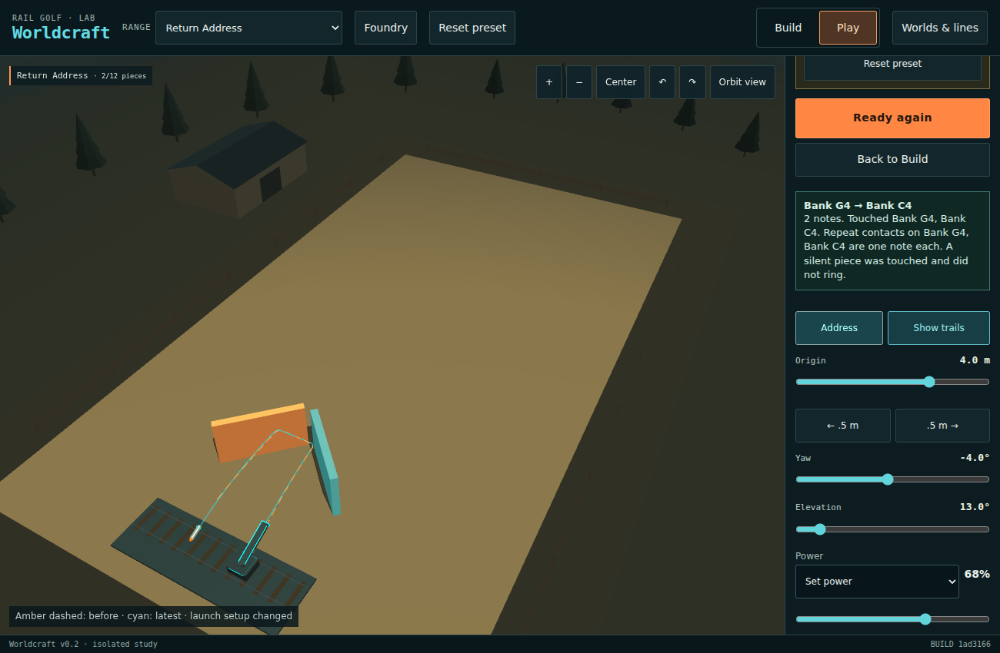

# Return Address · technical appendix

**Contains measured setups.** The [player introduction](PLAY.md) can be read separately.

## What the pieces contribute

The west and east banks form a right-angle corner pointing downrange. A left-hand serve can cross the space between the faces and leave travelling back toward the tee. The reply from the receiving side encounters the faces in reverse order. Timber and metal give the two contacts different voices. The sound has no effect on flight.

The third surface is the existing tee. Its 24 × 8 m deck already has its own collider and ends a line on first contact. That makes it possible to use the launcher's home as the receiving end of the shot. A landing supplies the lateral position for a fresh launch. One face is movable so the player can also steer a familiar serve by changing the corner itself.

## What counts as a return

For this study an opposite-deck landing requires the last ledger body to be the tee, a first-ground terminal, and a contact x on the other side of zero within the carriage limits of ±10 m. The intended two-face catch additionally requires exactly west, east, tee when serving from the west, or east, west, tee from the east. Consecutive solver callbacks on one contact are already grouped by the runtime. There is no game completion flag. All eight manifest shots have the existing `none` outcome.

The nearest receiving stop comes from the tee contact x displayed to two decimals in **Contact record**, rounded to a half metre. The table below reports the terminal **ball centre**. Those two positions differ slightly, especially at the deck lip.

## Representative Havok shots

All rows use 13° elevation except the short lob at 65°. Coordinates are metres. W and E are the west and east faces.

| Shot | Origin | Yaw | Power | Contact order | Terminal (x, z) | Time |
| --- | ---: | ---: | ---: | --- | ---: | ---: |
| Catalog opening | −4 | +4° | 58% | W, E, ground | (+3.56, +4.98) | 1.358 s |
| Lip catch | −4 | +4° | 62% | W, E, tee | (+3.76, +3.37) | 1.375 s |
| Serve | −4 | +4° | 68% | W, E, tee | (+3.99, +1.09) | 1.375 s |
| Reply from the observed stop | +4 | −4° | 68% | E, W, tee | (−4.00, +1.09) | 1.375 s |
| One yaw detent | −4 | +4.5° | 68% | W, E, tee | (+3.52, +1.14) | 1.375 s |
| Reply with the old yaw | +4 | +4° | 68% | E, W, tee | (−10.32, +2.14) | 1.375 s |
| Short lob | −4 | +70° | 0% | Tee only | (+1.68, +2.07) | 1.517 s |
| Straight into the seam | 0 | 0° | 68% | E, W, E, W, E, W, ground | (+0.03, +46.40) | 1.433 s |

The serve receipt reads x +3.98 and the reply reads x −3.98. Both round to the other sender's station. Keeping the old yaw on the reply also touches the deck, but its contact at −10.28 lies outside the carriage range. A weak lob from an extreme angle crosses the rail without touching a wall. The central seam produces six ledger contacts and then sends the ball away. Neither endpoint alone nor the number of bangs establishes an exchange.

## Neighbouring settings

At the opening origin and angles, the 35-shot sweep from 54% through 88% power found a two-face return on **every whole percent from 62 through 81**, inclusive. The first four power detents above the 58% opening lead from a visible shortfall to a lip catch. The center can sit slightly beyond the front edge of the deck while the sphere still touches it.

We also fired the full product of five origins (−5 through −3 m), seven yaw settings (+2.5° through +5.5°), five elevations (12° through 14°) and seven power settings (65% through 71%). Every interval is one actual editor step.

| Observation | Starting setups out of 1,225 |
| --- | ---: |
| Two-face catch on the first shot | 1,223 |
| Two-face catch again after throwing from the nearest receiving stop and reversing yaw | 1,138 |
| Both catches, with the second receiving stop within 0.5 m of the initial sender | 304 |

Identical reply setups were fired once each (1,056 unique replies). This box was selected around a known serve. The counts measure local tolerance, not how often a fresh player will discover the idea. Returning to the exact sender is a materially harder intention than keeping the exchange going.

At the serve settings, all six one-step edits of the east face preserve a two-face catch. Shift it 0.5 m right or downrange and the terminal moves from x +3.99 to about +4.52. Shift it left or nearer and it moves to +3.57. Turn the face from 45° to 40° or 50° and the terminal moves to +6.25 or +1.63 respectively. That makes one rotation easy to see and a coarse tool for fine correction.

## Simpler alternatives

From origin −4 m and elevation 13°, each layout received the same **1,053** shots: yaw −20° to +20° in 0.5° steps and power 52% to 76% in 2% steps. Every counted opposite-deck return in this grid had at least one downrange face contact. The comparison credits a one-face return fully.

| Geometry | Opposite-deck returns | What happens to the same +4°, 68% serve |
| --- | ---: | --- |
| Paired faces | 195 | Both faces, then tee at (+3.99, +1.09) |
| West angled face alone | 7 | One face, then ground at (+20.46, +16.38) |
| One flat face centred at the same depth | 117 | Exits the back of the yard at (−1.59, −8.14) |
| Empty yard | 0 | Ground at (−0.59, +48.78) |

The flat bank also makes a complete exchange. From −4 m, +14.5° yaw and 58% power, it sends the ball to (+3.98, −4.03). Reversing the yaw from the receiving stop sends it to (−3.98, −4.03). This is a viable one-wall version of catch. The corner allows a shallow aim, adds a visible cross-yard leg between contacts, and can steer the receiving address with one editable face. The tally describes this sampled window only.

## Player-control check

In desktop Chromium, Foundry → Return Address → Play opened Survey with the authored setup. The Fire button and the visible sliders reproduced the opening, serve and reply. All three terminal positions and elapsed times exactly matched the headless receipts. Amber and cyan trails were both present after the reply. In Build, moving the east face by one rightward detent and choosing **Make a copy** preserved that edit in a new saved world. **Reset** restored the authored face and launch. Opening the saved copy and then returning to the gallery confirmed that the two worlds remained independent.

The two successful trails nearly coincide in Survey. Their reversed contact orders are clearer in the ledger than in a still picture. This was an automated desktop check. Mobile input and human discovery were not tested.



[Browser receipts](browser.json)

## Authoring Vocabulary Assessment

| Area | Finding | Smallest useful extension |
| --- | --- | --- |
| Physical geometry and mechanisms | Two fixed-size faces and the existing tee sustain a two-way rally. The tee already distinguishes a deck catch from nearby earth. Ground termination provides a clean handoff between turns. | None needed for this world. |
| Authoring and validation | The validator reproduces exact terminals and outcome status. For this unscored world it cannot state that the measured line visited particular bodies in order. The short-lob control shows why that distinction matters. | Optional ordered body IDs on a manifest test shot, verified against the existing ledger. |
| Presentation and interaction | A free-launch, no-goal preset inherits a **Musical Workshop** heading and unrelated instructions. The contact x needed for the reply is several rows into an expandable record. Survey and its two trails already let the player inspect the geometry. | Use the card invitation in the generic panel. Surface the tee-contact x and nearest carriage stop in the result. The player still chooses where to launch. |
| Shot constraints and editor precision | 0.5° aim and 1% power suffice here. The 0.5 m carriage step still permits a recurring exchange. The deck protrudes beyond the carriage at both ends, and one 5° face turn shifts a return by several carriage stops. | Keep the current steps for this experiment. Treat a deck touch outside reachable carriage travel as a missed handoff. |

The unresolved question is whether a new player reads the landing as an invitation to throw back, and enjoys choosing where the next receiver should stand. No timed human discovery or owner trial has been run.

## Reproduction

The kit SHA is `1ad3166d0839ea042379f5a861ed7523cb46d47e`. Physics comes from the existing range harness and Havok WASM at 120 Hz. Seed 20261109 is run provenance. All listed setups use rail index 1. The experiment adds no application code beyond the gallery entry.

Checked with Node 22.23.4. The full build and test suite passed all 539 tests, and TypeScript passed. Run from the repository root with Node 22 and the locked dependencies installed.

```sh
node scripts/foundry/validate.mjs worlds/foundry/return-address
node scripts/foundry/return-address-check.mjs
node --test tests/worldcraft-foundry.test.mjs
npm test
npm run typecheck
```

[Validator stdout](validator.json) · [Measured terminals, contacts, controls and grid counts](measurements.json) · [Preset](../../../../worlds/foundry/return-address/preset.json) · [Manifest](../../../../worlds/foundry/return-address/manifest.json)
