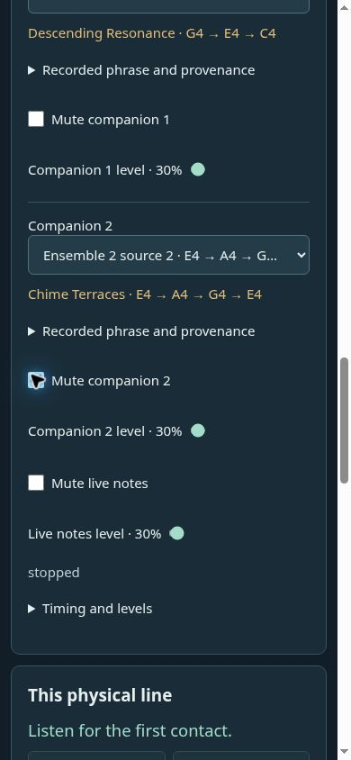

# Browser verification and boundaries

The local integrated player at `ff982702ee600452570d0c4ef98dcb23543a35bb`
was inspected in the cloud Chrome browser through ordinary UI controls. The
later report/script commits do not change this player. Actual browser audio
measurements are separately retained in `ensemble-browser-audio.md` and its JSON.

## Rendering limitation

The first local attempt found a development-only WASM asset path outside Vite's
worktree: the worktree's dependencies were a symlink into its sibling checkout.
Copying the same installed dependencies into this worktree removed that asset
restriction without changing application files, dependency versions or Vite's
file-access policy. The next load reported **WebGL not supported**. A separate
explicit diagnostic requesting a WebGL context returned `{ "webgl": false }`.

Consequently this session does **not** establish rendered mesh appearance,
occlusion, shadows, live browser physics/audio synchronization, GPU resource
cleanup, draw calls or frame performance. NullEngine Havok evidence is independent
of this browser failure. The supplied Hairpin images remain author captures.
No unavailable renderer was replaced with a decorative trajectory.

## Controls and scrolling

A temporary local, single-iframe viewport harness exercised the unchanged player
at ordinary browser zoom. The iframe dimensions model CSS viewport sizes, not
physical phones or their touch behavior. A populated four-arrangement library
from prior QA remained intact; no stored owner/QA records were cleared.

| CSS viewport | Main client width | Main scroll width | Main client height | Main scroll height |
| --- | ---: | ---: | ---: | ---: |
| 1280 × 800 | 1265 | 1265 | 800 | 3418 |
| 1024 × 600 | 1009 | 1009 | 600 | 3973 |
| 390 × 844 | 375 | 375 | 844 | 4886 |
| 844 × 390 | 829 | 829 | 390 | 3471 |

These DOM measurements show a scrollable main region with no horizontal content
overflow in the tested state. Portrait companion selection, mute and level
controls were visible and reachable. Landscape scrolling reached the bottom
Stop control, saved arrangements and footer. Tab moved from Download kept lines
to Export physical lines. Two sources from different reference instruments were
selected without changing the live-world selection or automatically playing.
The Fire label correctly changed to two companions. Stop remained reachable.

The world menu lists the two references and all three original submissions.
Fire, opening, station/world and camera actions are correctly disabled after
renderer initialization fails. Therefore their **successful live UI operation**,
new Keeps and new cross-instrument browser performances were not certified here.
Their unchanged implementation, source round-trips, actual-Havok sessions and
ensemble independence are covered by the separate automated reviews.

An attempted browser download did not yield a completed download handle before
the automation session timed out. Treat browser export delivery as unverified,
not a passed download check or an established application defect. Export format
and import/recording compatibility pass the repository and ensemble checks.
Owner play should include downloading and re-importing a small recording.

The temporary viewport page, audio page and public fixture copy were removed
before the final build. The audio diagnostic installer remains as a reproducible
developer tool; no diagnostic panel was added to ordinary exhibition play.
