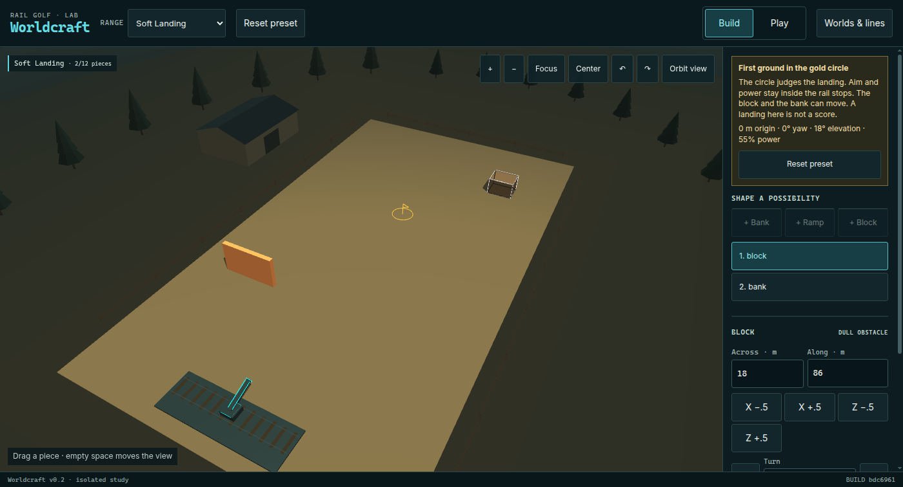
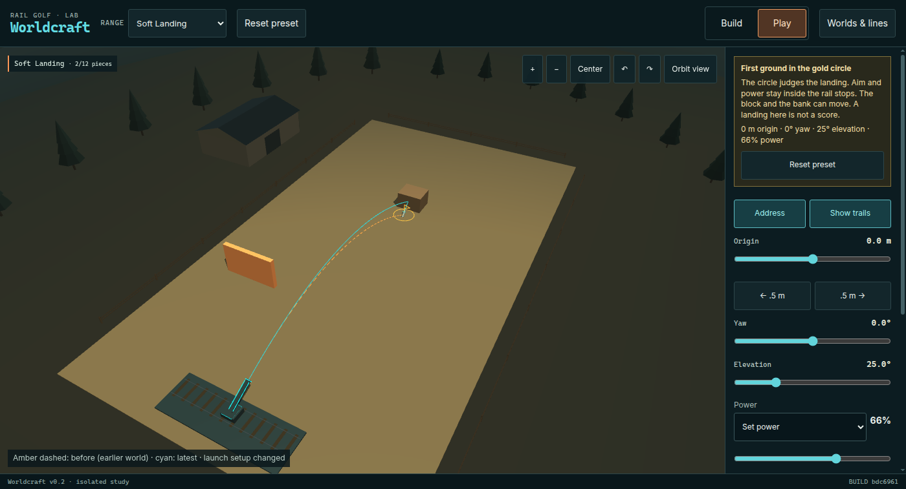

# Soft Landing

Lane C of the experimental range. Player question: can you build a line that's easier to repeat? Hypothesis: a backstop or redirecting object can make a difficult landing tolerant of small aim and power differences.

Base `bdc6961dd19b148174f2b5c0a92cb2fd171fc43a` on `lab/wc-range-20261024`. Implementation `e045039b15c30e3c7e89c7d882be523f9dd2a92c` on `lab/wc-range-c-soft-landing`. Every provenance line in the JSONL below records that implementation SHA, Node v22.23.4, seed `20261024`, catalog `worldcraft-prefabs-v2`, physics `rail-golf-v02-worldcraft-v1`, 120 Hz, substep `1000/120`, gravity 12, mass 1.5, radius 0.43. The seed is recorded. It is applied only to the player-walk generator. It is not applied to Havok.

This page is the measurement record. The range index stays free of landing numbers.

## Preset

One preset, `soft-landing`, name Soft Landing. Goal `first-ground-zone` at `(0, 64)` with radius 2.5 m. The gold circle is the judged zone. It has no collider. First ground contact ends the line. The judged point is the round's centre. A clear is `outcome.scored === true` for that zone. There is no production score.

Allowance is one bank and one block. Nothing is locked. The launcher is adjustable: `rules.launcher.fixed` is false, which compiles to `rules.rail: null`. Stored yaw, elevation, and charge are the starting aim. Shot bounds are the existing ones: origin x from −10 m to 10 m on a 0.5 m step, yaw ±70°, elevation 5–85°, charge 0–1. Charge still maps as speed `6 + 37 * charge` (6–43 m/s). Piece x and z move on a 0.5 m step. Piece yaw moves on a 5° step from −180° to 175°.

Opening arrangement, preset hash `f981320378ddcb92c4bf6a162189df6bf11a79ca77cd77adcba5571952560db3`:

| Piece | Kind | Pose |
| --- | --- | --- |
| `backstop` | block, 6 × 4 × 5 m, friction 0.8, restitution 0.1 | x 18, z 86, yaw 0 |
| `redirect` | bank, 12 × 7 × 1 m, friction 0.18, restitution 0.86 | x −18, z 28, yaw 0 |

Starting aim: origin 0 m, yaw 0°, elevation 18°, charge 0.55. That shot misses. First ground is `(0, 0.43000003695487976, 46.14754867553711)`, distance 17.85245132446289 m, elapsed 1.6416666666666633 s, contact `worldcraft-ground` only. The opening pose is the parked pose. It is the arrangement a player enters. It is not the forgiving solution.

## Two arrangements, one zone

Both appendix solutions use this same circle. The fragile solution keeps the opening pieces and changes only the aim. The forgiving solution moves the dull block so its near face (centre z minus half of the 5 m depth) sits on the circle's back edge at z 66.5, and raises charge. The bank stays parked in both.

| | Fragile | Forgiving |
| --- | --- | --- |
| File | [appendix/soft-landing/fragile.json](appendix/soft-landing/fragile.json) | [appendix/soft-landing/forgiving.json](appendix/soft-landing/forgiving.json) |
| Preset hash | `5223f22e33796059e08741c94c81209581913a21a830ed8661bc3cb414217e1a` | `a81bb95cb06c3bf4212a2b1669635db9bf124912caf0981b7176dcf081b369f5` |
| Block | x 18, z 86, yaw 0 | x 0, z 69, yaw 0 |
| Bank | x −18, z 28, yaw 0 | x −18, z 28, yaw 0 |
| Aim | origin 0, yaw 0°, elevation 25°, charge 0.61 | origin 0, yaw 0°, elevation 25°, charge 0.66 |
| Landing | `(0, 0.43000003695487976, 63.50059509277344)` | `(0, 0.43000009655952454, 63.808963775634766)` |
| Distance | 0.4994049072265625 m | 0.19103622436523438 m |
| Elapsed | 2.2666666666666613 s | 2.4416666666666607 s |
| Contacts | `worldcraft-ground` | `worldcraft-object-backstop`, then `worldcraft-ground` |

The fragile shot is a direct ballistic. It does not touch the block. The same forgiving aim on the fragile pieces misses: first ground `(0, 0.4300000071525574, 70.53123474121094)`, distance 6.5312347412109375 m, elapsed 2.3833333333333275 s, ground only, preset hash still the fragile hash. Compiled world identity follows objects, launcher x, and rules. With `rail: null`, the stored aim is outside that identity, so the fragile document and the opening document share a world identity. Their preset hashes differ because the stored aim differs. The forgiving document's identity differs because the block moved.

Representatives were locked in those two files before the official neighborhood, and the measurement checks them. It does not search for a new pair. Shared aim is elevation 25°, yaw 0°, origin 0 m. Fragile charge 0.61 is the 0.01 player detent nearest the midpoint of the direct charge run measured below (0.596 and 0.630, midpoint 0.613). Forgiving block z 69 is the pose whose charge sweep below is one contiguous run wider than that direct run. Charge 0.66 is inside that run and is the stored shot that contacts the block. A block at z 71, two metres deeper, does not give that shot a single wider run; see the control.

## What the corrected Backstop review already said

`docs/WORLDCRAFT-REPORT-REVIEW.md`, blob `6775a5523a07cef31c2ba9db63565149e057c62e`. Direct versus a block at the back edge: 65 and 132 hits per 5,239 sampled setups. The same block 2 m deeper: 96 per 5,239. The report's best power runs are 2 samples versus 6 samples at 2-point spacing. Those endpoint spans are 2 points and 10 points. They are not continuous 4% and 12% windows. A grid count is not a player's chance of landing the shot. The supplied JSON had `rules: null`, so a pin and a locked launcher were assumptions.

This lane keeps that correction. Widths below are contiguous runs on a stated step, with the miss on each side when the run is bracketed. Counts of a coarse grid are reported in their own section and are not converted into a width or a probability.

## Three procedures, kept apart

1. Uniform grid. A pre-specified coarse lattice over origin, yaw, elevation, and charge. Output is a count of clears and the list of those cells.
2. Targeted neighborhood. Dense samples around one representative success. A width is the inclusive run that contains that representative. A gap splits runs. Width is `(count − 1) * step`. An area is the 4-connected component of clears around the representative cell (edge neighbors, not diagonals). Area is `count * stepA * stepB`. It is not the bounding box. A run or component that touches an untested side is censored. An illegal piece pose is recorded as a non-clear and is not simulated. A bracket that fails the yard footprint is an illegal pose, not a measured physical miss.
3. Player-like search. From a miss, take one random legal detent on one axis and fire. Axes are yaw ±0.5°, elevation ±0.5°, charge ±0.01, origin ±0.5 m, and each piece's x, z (±0.5 m) and yaw (±5°). An illegal nudge is rejected and the state stays. The generator is mulberry32 of `seed + trial`.

Neighborhood steps are denser than the player detents on the continuous aim axes: yaw 0.25°, elevation 0.25°, charge 0.002. The yaw×charge area uses 0.5° and 0.005. Origin and piece pose stay on the enforced grid, so those widths cannot be finer than 0.5 m or 5°.

Raw rows:

| Procedure | File |
| --- | --- |
| Uniform grid | [runs/soft-landing-grid.jsonl](runs/soft-landing-grid.jsonl) |
| Neighborhood, including the deeper-block charge sweep | [runs/soft-landing-neighborhood.jsonl](runs/soft-landing-neighborhood.jsonl) |
| Yaw×charge areas and the block x×z area | [runs/soft-landing-area.jsonl](runs/soft-landing-area.jsonl) |
| Player walks | [runs/soft-landing-player.jsonl](runs/soft-landing-player.jsonl) |
| Four reproduction shots | [runs/soft-landing-reproduction.jsonl](runs/soft-landing-reproduction.jsonl) |

The folded numbers are [appendix/soft-landing/summary.json](appendix/soft-landing/summary.json). Each JSONL call starts with a provenance object. `worlds` is `per-setup` when the world changes inside the call.

## Uniform grid

Lattice, chosen in advance: origin −4, 0, 4 m × yaw −12, −6, 0, 6, 12° × elevation 18, 24, 30, 36° × charge 0.45, 0.55, 0.65, 0.75. That is 240 setups. The representatives (elevation 25°, charge 0.61 and 0.66) are not on this lattice.

| World | Clears / 240 | Cells (origin, yaw, elevation, charge) |
| --- | --- | --- |
| Opening pieces | 1 | (0, 0, 36, 0.55) |
| Forgiving block | 3 | (0, 0, 18, 0.75), (0, 0, 24, 0.65), (0, 0, 36, 0.55) |

These are lattice counts. They are not tolerance widths and not a player's chance of repeating the shot.

## Neighborhood widths

Scans, same on both arrangements unless noted: yaw −8° to 8° at 0.25°; elevation 16° to 36° at 0.25°; charge 0.54 to 0.74 at 0.002; origin −10 m to 10 m at 0.5 m (the full legal origin). Every aim width below is bracketed on both sides and is not censored. One run contains the representative.

| Axis | Fragile | Forgiving |
| --- | --- | --- |
| Yaw | −2° to 2°, width 4°, 17 samples, brackets −2.25° and 2.25° | −2° to 2°, width 4°, 17 samples, brackets −2.25° and 2.25° |
| Elevation | 23.75° to 27.25°, width 3.5°, 15 samples, brackets 23.5° and 27.5° | 20° to 26.5°, width 6.5°, 27 samples, brackets 19.75° and 26.75° |
| Charge | 0.596 to 0.630, width 0.034, 18 samples, brackets 0.594 and 0.632 | 0.596 to 0.678, width 0.082, 42 samples, brackets 0.594 and 0.68 |
| Origin x | −2 m to 2 m, width 4 m, 9 samples, brackets −2.5 m and 2.5 m | −2 m to 2 m, width 4 m, 9 samples, brackets −2.5 m and 2.5 m |

Charge width 0.082 against 0.034 is 41/17 of the direct run. Elevation width 6.5° against 3.5° is 13/7 of the direct run. Yaw and origin widths are the same on both arrangements. A dull face drops the ball near the contact's x. On these representatives it does not widen yaw or origin.

### Piece pose

Forgiving block, aim held at the forgiving representative. These three runs are bracketed and not censored. The brackets are simulated misses.

| Axis | Run | Width | Brackets |
| --- | --- | --- | --- |
| x, step 0.5 m, scan −8 to 8 | −3 to 3, 13 samples | 6 m | −3.5 and 3.5 |
| z, step 0.5 m, scan 60 to 84 | 67.5 to 70.5, 7 samples | 3 m | 67 and 71 |
| yaw, step 5°, scan −180 to 175 | −20° to 20°, 9 samples | 40° | −25° and 25° |

The block x×z area on a 0.5 m grid, scan x −6 to 6 and z 64 to 78, is one 4-connected component: 91 cells, area 22.75 m², x from −3 to 3, z from 67.5 to 70.5, not censored. A filled rectangle on those extremes would be 13 by 7 = 91 cells, so this component fills that box. The area figure is still the component, not a separate bounding-box measurement.

The bank on the forgiving shot, and both pieces on the fragile shot, sit off the line that was fired. Their scans run into the edge of the scan or into a pose the yard rejects. Those widths are not a measured physical tolerance of an object the shot uses.

| Scan | What the run did |
| --- | --- |
| Fragile block x, 0 to 24 m | Clears the whole scan, 0 to 24. Both ends censored. |
| Fragile block z, 60 to 96 m | Clears 60 to 93.5. The low end is the scan start. The high bracket 94 is an illegal footprint (the block does not fit in the yard). 93.5 is the last legal sample in the scan. |
| Fragile block yaw, −180° to 175° | Clears the whole legal yaw range. Both ends censored. |
| Fragile bank x, −27 to −6 m | Clears −24 to −6. The low bracket −24.5 is an illegal footprint. The high end is the scan end and is censored. |
| Fragile bank z, 16 to 48 m | Clears the whole scan. Both ends censored. |
| Fragile bank yaw | Clears the whole legal yaw range. Both ends censored. |
| Forgiving bank, same scans | Same pattern: x clears −24 to −6 with an illegal −24.5 bracket and a censored high end; z and yaw are censored at both ends of the scan. |

## Yaw × charge area

Grid: yaw −4° to 4° at 0.5°. Charge 0.55 to 0.70 at 0.005 on the fragile aim, and 0.55 to 0.74 at 0.005 on the forgiving aim. Both components are not censored.

| | Cells | Area (degree · charge) | Yaw extent | Charge extent |
| --- | --- | --- | --- | --- |
| Fragile | 51 | 0.1275 | −2° to 2° | 0.6 to 0.63 |
| Forgiving | 120 | 0.3 | −2° to 2° | 0.6 to 0.675 |

The area ratio is 120/51 = 40/17. The yaw extent stays −2° to 2°. The extra area is charge. The component is smaller than the rectangle of its extremes: 9 × 7 = 63 cells would fill the fragile extremes, and 9 × 16 = 144 cells would fill the forgiving extremes.

## Block two metres deeper

Same forgiving aim, block z set to 71, charge swept from 0.54 to 0.74 at 0.002. Clears form two islands:

| Island | Charge | Width | Samples |
| --- | --- | --- | --- |
| First | 0.596 to 0.630 | 0.034 | 18 |
| Second | 0.666 to 0.692 | 0.026 | 14 |

Charge 0.66 is between the islands and misses. The span from 0.596 to 0.692 is not one window. Placement of the dull block changes the charge run. Putting the block on the circle's back edge is the pose that widened the representative's run. Moving it 2 m deeper splits that run, which is the same qualitative placement result as the review's 65 / 132 / 96 grid counts, stated here as contiguous widths.

## Player-like search

This section is the walk. It is not a width.

From the opening aim (elevation 18°, charge 0.55, parked pieces), 30 trials of 40 steps, seeds `20261024` through `20261024 + 29`. All 1,200 nudges were legal and were fired. Trials that cleared: 0. Protocol: [appendix/soft-landing/player-opening.json](appendix/soft-landing/player-opening.json).

A second walk starts one player detent below the shared charge bracket. `floor(0.594 * 100) / 100` is 0.59. Both arrangements therefore start at charge 0.59, elevation 25°, yaw 0°, origin 0, on their own pieces. Twenty trials of 12 steps. Fragile seeds `20261024 + 1000` onward: 9 trials cleared, first-clear step indexes 9, 3, 3, 1, 8, 1, 3, 3, 8. Forgiving seeds `20261024 + 2000` onward: 6 trials cleared, first-clear step indexes 5, 2, 1, 1, 0, 1. Step 0 is the first nudge, not the unfired start. Each walk fired 240 shots. Protocol: [appendix/soft-landing/player-near.json](appendix/soft-landing/player-near.json).

The two walks start on the same low charge edge, so they do not show that the backstop is easier to stumble into. The 9 and 6 counts are the outcomes of these seeds. They are not a success rate.

## Reproduction

Headless, one `runRange` call, four setups, file `runs/soft-landing-reproduction.jsonl`: opening miss, fragile clear, forgiving clear, and the forgiving aim on the fragile pieces (miss). Terminals, distances, contacts, and preset hashes match the table above. The range test fires the forgiving preset twice and requires equal terminals and equal judged points, and it requires the v1 world identity hash `127a033284941a110bd174e59e51700f5bdce4ca3b74a6f6c381786586141389` to stay put.

Browser, headless Chrome, SwiftShader (`--use-gl=angle --use-angle=swiftshader-webgl`), `/lab/worldcraft?qa=1`. These frames are software rendering. They are not a phone and not a desktop GPU. Report: [appendix/soft-landing/browser-report.json](appendix/soft-landing/browser-report.json).

Entering Soft Landing left the rail null and the starting aim at 18° / 0.55. The fragile shot and the forgiving shot matched the headless terminals exactly, including distance 0.4994049072265625 and 0.19103622436523438. After the block was placed at `(0, 69, yaw 0)`, the amber trail was the recorded fragile sample list (`worldcraft-before-line`) and the cyan trail was the new shot (`worldcraft-actual-line`). Save/reload returned ok, rebuilt physics once in that call (1.3999999999068677 ms), and left 4 static bodies. Importing `forgiving.json` restored block z 69 and aim 25° / 0.66. Two imported fires scored, and they shared one terminal and binding hash `9ba3a89bf917f3bd774b63d5084a9f1230d946ab2b7d44bfcee87086dfb2c73a`. The imported preset hash is the forgiving hash above.

Opening preset in Build. The gold circle is in the yard. The block is parked off the right (inspector across 18 m, along 86 m). The bank is off the left side of the approach. The aim readout is 0 m origin, 0° yaw, 18° elevation, 55% power.

Play, after the fragile shot and then the forgiving shot. The block now sits on the far side of the circle. Amber dashed is the earlier world. Cyan is the latest shot, bent at the block. Sliders read 0 m origin, 0° yaw, 25° elevation, 66% power. The caption on screen is "Amber dashed: before (earlier world) · cyan: latest · launch setup changed".

## Shared range changes

Kept small, and limited to letting one preset aim for itself and to measuring that preset.

- Schema v1 accepts `launcher.fixed: false`. That compiles to `rail: null`. `fixed: true` still requires a locked rail. Open Workshop stays locked. `rangeStartingSetup` returns the stored aim when the rail is unlocked, so enter, reset, and import have a shot to restore.
- The runner rebuilds physics when `worldcraftIdentity` changes, and it accepts `documentAt` plus `labels` so one call can shoot more than one world. The CLI takes `--preset-file` or `--preset`, not both.
- The lab's goal note for `first-ground-zone` says the circle is judged and that the landing is not a score. House Shot still uses its pin wording. An adjustable preset's play note says to aim within the rail stops.
- `scripts/range/tolerance.mjs` is measurement arithmetic. It does not run a shot.

Committed-shot physics, charge mapping, first-kiss, first-ground, score, progression, Timber Courtyard, Railyard, art, and Free Play are unchanged. The v1 identity hash above is the regression the range test still checks.

## What this record establishes

On these two representatives, a dull block with its near face on the back edge of the circle widens the contiguous charge run from 0.034 to 0.082 and the elevation run from 3.5° to 6.5°, and it widens the yaw×charge component from 0.1275 to 0.3 degree·charge. The block itself has a bracketed placement region of 6 m in x, 3 m in z, and 40° in yaw, and a 22.75 m² 4-connected footprint on the 0.5 m grid. Moving that block 2 m deeper splits the charge sweep into islands of width 0.034 and 0.026, and charge 0.66 misses. The opening arrangement misses by 17.85245132446289 m. The forgiving aim on the parked pieces misses by 6.5312347412109375 m.

## What is not established

- A human chance of repeating the landing. No player was measured. The grid's 1/240 and 3/240, and the walks' 0/30, 9/20, and 6/20, are counts of stated procedures.
- That the backstop widened yaw or origin. Those widths stayed 4° and 4 m.
- That a random local walk from the opening aim finds a clear. None of the 30 trials did.
- That the near-bracket walk shows the backstop is easier to find. Both walks start at charge 0.59, and the forgiving walk cleared on fewer of its seeds.
- A physical edge for a piece the representative shot does not touch. Those scans are censored, or their brackets are illegal footprints.
- That the lively bank is the forgiving object. Both official arrangements leave it parked. A coarse design search of centreline banks was not promoted into these JSONL files, and its samples are not a result of this record.
- Any structure finer than the sample step. A clear run can hide a miss between samples. Origin and piece pose cannot be sampled finer than the enforced 0.5 m and 5° grids.
- Fun, discoverability, or phone play. The screenshots are SwiftShader.
- Any change to committed-shot physics, score, progression, Free Play, or the v1 world identity.
